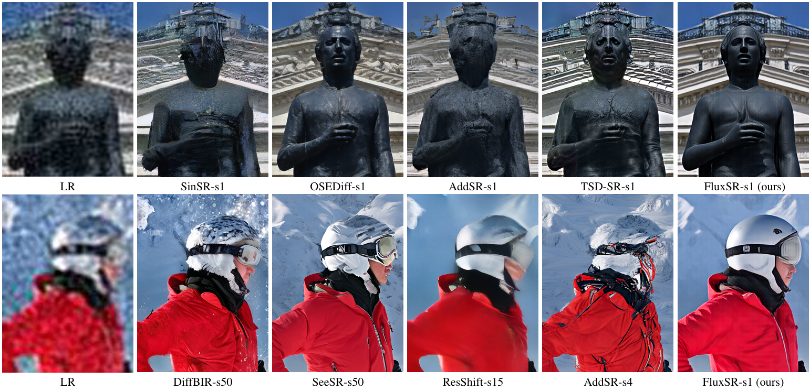
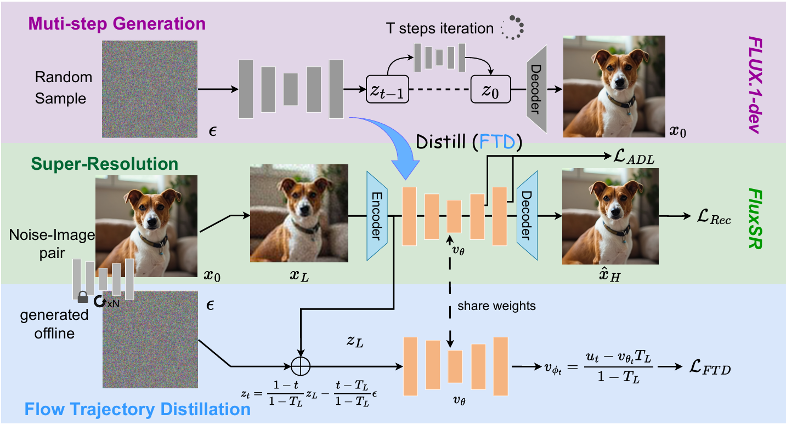
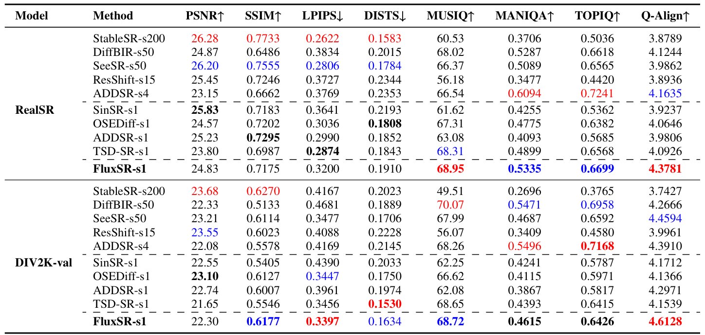
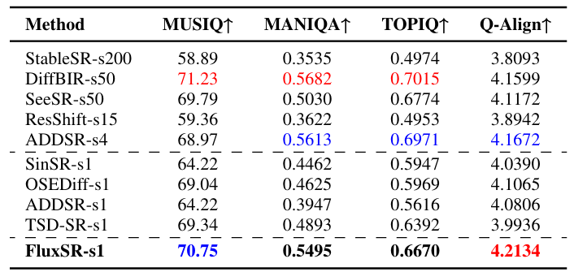
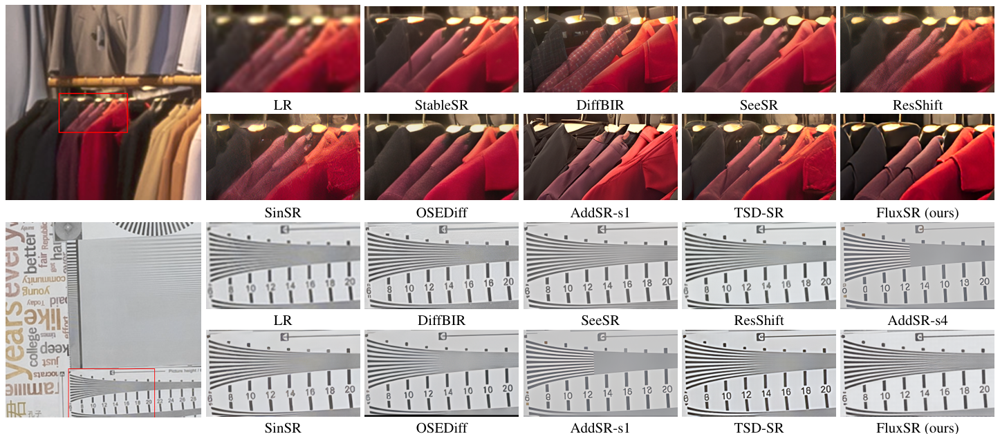

<div align="center">

<h1>FluxSR</h1>
<h3>One Diffusion Step to Real-World Super-Resolution<br>via Flow Trajectory Distillation</h3>

<p><strong>ICML 2025</strong></p>

<p>
  Jianze Li,
  <a href="https://www.jiezhangcao.com/">Jiezhang Cao</a>,
  <a href="https://www.guoyongcs.com/">Yong Guo</a>,
  <a href="https://fenglinglwb.github.io/">Wenbo Li</a>, and
  <a href="http://yulunzhang.com/">Yulun Zhang<sup>*</sup></a>
</p>

<p>
  <a href="https://arxiv.org/abs/2502.01993"></a>
  <a href="https://huggingface.co/mon3tr/FluxSR-private"></a>
  <a href="LICENSE"></a>
</p>

<p>
  <a href="https://github.com/JianzeLi-114/FluxSR"></a>
  <a href="https://github.com/JianzeLi-114/FluxSR/stargazers"></a>
  <a href="https://github.com/JianzeLi-114/FluxSR/forks"></a>
  <a href="https://huggingface.co/mon3tr/FluxSR-private/tree/main"></a>
</p>

<p>
  <a href="README.md">English</a> &nbsp;|&nbsp; <strong>简体中文</strong>
</p>

<p>
  <a href="https://proceedings.mlr.press/v267/li25a.html">论文</a> &nbsp;·&nbsp;
  <a href="https://arxiv.org/abs/2502.01993">arXiv</a> &nbsp;·&nbsp;
  <a href="#models">预训练模型</a> &nbsp;·&nbsp;
  <a href="#training">训练</a> &nbsp;·&nbsp;
  <a href="#testing">推理</a> &nbsp;·&nbsp;
  <a href="#results">结果</a>
</p>

</div>

#### 🔥 动态

- **2026-10-13：** FluxSR 训练、推理和评测代码现已公开，同时提供 [Hugging Face 模型包](https://huggingface.co/mon3tr/FluxSR-private)和中文 README。
- **2025-02-03：** 本仓库发布。

---

> **摘要：** 扩散模型（DMs）显著推动了真实世界图像超分辨率（Real-ISR）的发展，但多步扩散模型的计算开销限制了其应用。单步扩散模型只需一次采样即可生成高质量图像，大幅降低计算开销和推理延迟。然而，现有大多数单步扩散方法受限于教师模型的性能，教师模型表现不佳时会产生图像伪影。为解决这一问题，我们提出 FluxSR，一种基于流匹配模型的新型单步扩散 Real-ISR 方法。我们使用先进的扩散模型 FLUX.1-dev 同时作为教师模型和基座模型。首先，我们提出流轨迹蒸馏（FTD），将多步流匹配模型蒸馏为单步 Real-ISR 模型。其次，为提高图像真实感并解决生成图像中的高频伪影问题，我们提出 TV-LPIPS 感知损失，并引入注意力多样化损失（ADL）作为正则项，以降低 Transformer 中词元之间的相似度，从而消除高频伪影。广泛的实验表明，该方法优于现有基于单步扩散的 Real-ISR 方法。

<p align="center">
  
</p>

---

### 方法流程

<p align="center">
  
</p>

---

## 🔗 目录

- [依赖安装](#dependencies) · [模型](#models) · [数据集](#datasets)
- [训练](#training) · [推理](#testing) · [评测](#evaluation)
- [结果](#results) · [发布](#publishing) · [引用](#citation) · [致谢](#acknowledgements) · [许可](#license)


<a id="dependencies"></a>

## ⚙️ 依赖安装

- Python 3.11
- PyTorch 2.5.1 / Torchvision 0.20.1 / CUDA 12.4
- Diffusers、Transformers、PEFT、Accelerate 和 PyIQA

请在仓库根目录运行以下命令。

```bash
git clone https://github.com/JianzeLi-114/FluxSR.git
cd FluxSR
python3.11 -m venv .venv
source .venv/bin/activate
pip install torch==2.5.1 torchvision==0.20.1 --index-url https://download.pytorch.org/whl/cu124
pip install -r requirements.txt
```

依赖文件固定使用 Diffusers 0.37.1、Transformers 5.5.0、PEFT 0.18.1、
Accelerate 1.13.0 和 PyIQA 0.1.15.post2。Q-Align 使用独立环境，
详见[评测](#evaluation)部分。

<a id="models"></a>

## 📦 模型

| 模型 | 说明 | 下载 | 本地路径 |
|:---|:---|:---|:---|
| FLUX.1-dev | 基座模型与教师模型 | [Hugging Face](https://huggingface.co/black-forest-labs/FLUX.1-dev) | `pretrained/FLUX.1-dev/` |
| **FluxSR** | LoRA 权重、配置、固定文本嵌入和训练提示词 | [Hugging Face](https://huggingface.co/mon3tr/FluxSR-private) | `weights/fluxsr/` |

请先接受
[black-forest-labs/FLUX.1-dev](https://huggingface.co/black-forest-labs/FLUX.1-dev)
的访问条件，再下载**基座模型**。基座权重采用单独的许可，
不包含在本项目的模型包中。

```bash
hf auth login
hf download black-forest-labs/FLUX.1-dev --local-dir pretrained/FLUX.1-dev
export MODEL_ID="$PWD/pretrained/FLUX.1-dev"
```

下文中的 `MODEL_ID` 也可以使用已有的本地模型目录，
或已通过身份验证的 Hugging Face 模型 ID。

[FluxSR 模型包](https://huggingface.co/mon3tr/FluxSR-private)已公开，可直接下载完整模型包：

```bash
export HF_MODEL_REPO="mon3tr/FluxSR-private"
hf download "$HF_MODEL_REPO" --local-dir weights/fluxsr
```

配置和评测结果见[模型卡](weights/fluxsr/README.md)。
适配器目录包含 LoRA 权重、`training_config.json`、
固定文本嵌入、`prompts_10k.json` 和模型许可。
这些模型文件及 JSON 文件托管在 Hugging Face，不由 GitHub 跟踪。

```text
weights/fluxsr/
├── pytorch_lora_weights.safetensors
├── training_config.json
├── t5_embedding.pth
├── clip_embedding.pth
├── prompts_10k.json
├── README.md
├── FLUX.1-dev-LICENSE.md
└── NOTICE
```

<a id="datasets"></a>

## 📁 数据集

| 用途 | 数据集 | 准备方式 | 本地路径 |
|:---|:---|:---|:---|
| 训练 | FLUX 生成的噪声—图像对 | [生成数据对](#training-data) | `data/flux_pairs_10k/` |
| 测试 | 自己的低分辨率图像，可选配对应真值图像 | [目录结构](#test-data) | `data/example/` |

<a id="training-data"></a>

### 训练数据

模型包中的 `weights/fluxsr/prompts_10k.json` 包含 10,000 条提示词。
使用 FLUX.1-dev 教师模型生成训练数据对：

```bash
MODEL_ID="$MODEL_ID" NPROC_PER_NODE=8 bash scripts/generate_data.sh
```

生成的数据以分片 LMDB 的形式存放在 `data/flux_pairs_10k`。
每条记录包含配对的初始噪声、教师输出潜变量、解码后的
1024 × 1024 图像、提示词索引和随机种子。
教师模型使用 50 步采样、guidance 3.5，以及种子 `10 + prompt_index`。
生成过程使用 BF16 模型权重，潜变量和图像数组以 FP16 保存。

<details>
<summary><strong>生成选项</strong></summary>

默认每张 GPU 的提示词批大小为 4，VAE 解码批大小为 1。
生成任务会将尚未完成的提示词分配给各工作进程，
并通过跳过已有的提示词键来恢复任务。可以修改路径和批大小：

```bash
MODEL_ID="$MODEL_ID" \
PROMPT_PATH=weights/fluxsr/prompts_10k.json LMDB_PATH=data/flux_pairs_10k \
NPROC_PER_NODE=8 GEN_BATCH_SIZE=4 \
bash scripts/generate_data.sh
```

首次小规模试运行时，可添加 `MAX_SAMPLES=8`。
之后去掉该变量，在同一目录下重新运行，即可完成全部 10,000 条提示词对应的数据对生成。
更换提示词、教师模型或生成设置时，请使用新的输出目录。

</details>

<a id="test-data"></a>

### 测试数据

将低分辨率图像放在 `input/` 下。如需全参考评测，
请将对应的高分辨率真值图像放在 `gt/` 下：

```text
data/example/
├── input/
│   ├── image001.png
│   └── image002.png
└── gt/
    ├── image001.png
    └── image002.png
```

真值图像的尺寸应与预测图像一致。
没有真值图像时，可使用下文的无参考评测命令。

<a id="training"></a>

## 🔧 训练

从基座模型开始训练 FluxSR：

```bash
MODEL_ID="$MODEL_ID" LMDB_PATH=data/flux_pairs_10k \
OUTPUT_DIR=exp/fluxsr NPROC_PER_NODE=8 \
bash train.sh
```

> 💡 训练使用八张 A800 80 GB GPU，每张 GPU 处理一张图像。
> 每 1,000 步保存一次检查点；每 5,000 步的检查点永久保留。

请为生成的 LMDB 数据对预留约 80 GB 磁盘空间。

<details>
<summary><strong>训练配置与断点恢复</strong></summary>

| 设置 | 默认值 |
|---|---|
| 训练数据对 | 全部 10,000 个生成数据对 |
| 训练步数 | 20,000 |
| 批大小 | 每张 GPU 为 1；全局批大小为 8 |
| LoRA rank / alpha | 64 / 64 |
| 学习率 / 预热步数 | 1e-5 / 500 步 |
| 条件时间步 / guidance | 350 / 4.0 |
| 损失 | 空间域 MSE FTD、LPIPS 1.0、TV-LPIPS 1.0、ADL 0.1 |
| 精度 | 冻结权重为 BF16；可训练适配器为 FP32 |
| 梯度检查点 | 启用 |
| 训练随机种子 | 114 |
| 退化配置 | `dataset/realesrgan_paper.yaml` |

ADL 在全部 57 个 Transformer 块上，对每个图像词元与图像词元均值表示之间的
余弦相似度取平均。

通过 `TRAIN_ITERS` 可修改训练长度。
修改 `NPROC_PER_NODE` 也会改变全局批大小。
使用以下命令恢复完整检查点，包括优化器、调度器和随机数生成器状态：

```bash
MODEL_ID="$MODEL_ID" LMDB_PATH=data/flux_pairs_10k \
OUTPUT_DIR=exp/fluxsr \
RESUME_FROM=/path/to/full/checkpoint_010000 \
bash train.sh
```

检查点保存在
`exp/fluxsr/<timestamp>_seed114/checkpoint_<step>/`；
请指定所选检查点的完整路径。恢复时会载入已保存的优化器步数和训练状态。
`weights/fluxsr` 模型包包含用于推理的 LoRA 权重与配置。

</details>

<a id="testing"></a>

## 🔨 推理

对单张图像或整个目录执行 ×4 超分辨率：

```bash
python inference.py \
  --input /path/to/input.png \
  --output results/example \
  --model "$MODEL_ID" \
  --lora weights/fluxsr \
  --seed 114
```

> 💡 使用 `--offload sequential` 可降低 GPU 显存占用，
> 使用 `--vae-tiling` 可对大图像进行分块解码。
> 运行 `python inference.py --help` 查看全部选项。

<details>
<summary><strong>推理设置</strong></summary>

向 `--input` 传入目录即可处理其中的图像。输出始终为目录。
推理执行 ×4 超分辨率；时间步 350、guidance 4 和
LoRA rank/alpha 64/64 从随附的 `training_config.json` 读取。

评测使用完整图像推理，冻结基座权重为 BF16，LoRA 参数为 FP32，
不进行颜色校正，也不启用 VAE 分块。采样种子为排序后输入列表中的
`seed + image_index`；复现实验时请保持完整的输入列表。
对列表中的单张图像运行推理时，可将 `--image-index`
设为它在原列表中的从零开始的索引，以使用相同种子。

下文的评测命令采用完整图像推理。
固定文本嵌入从 `weights/fluxsr/` 加载。
短边小于 128 像素的输入会先放大，再进行推理，
最后将结果缩放回原输入尺寸的 4 倍。
可以用 `--t5-embedding` 和 `--clip-embedding` 指定其他文件路径。

</details>

<a id="evaluation"></a>

## 📏 评测

先对输入图像运行推理，再根据是否具有真值图像进行评测。

```bash
python inference.py \
  --input data/example/input \
  --output results/example/pred \
  --model "$MODEL_ID" \
  --lora weights/fluxsr \
  --seed 114

python scripts/evaluate.py \
  --pred-dir results/example/pred \
  --gt-dir data/example/gt \
  --output-dir results/example/metrics \
  --color-space y \
  --fail-on-metric-error
```

提供 `--gt-dir` 时，默认计算 PSNR、SSIM、LPIPS、DISTS、MUSIQ、
MANIQA 和 TOPIQ-NR。没有真值图像时，默认计算 MUSIQ、MANIQA 和 TOPIQ-NR：

```bash
python scripts/evaluate.py \
  --pred-dir results/example/pred \
  --output-dir results/example/metrics_nr \
  --fail-on-metric-error
```

评测脚本生成 `per_image.csv` 和 `summary.json`。
预测图像与真值图像必须尺寸一致；评测过程中不会对图像进行缩放或对齐。

<details>
<summary><strong>配对规则与指标选项</strong></summary>

默认按去掉扩展名后的相对路径配对。例如，预测目录下的
`scene/image001.png` 与真值目录下的 `scene/image001.jpg` 配对。

- `--match-mode relative`：按去掉扩展名后的相对路径匹配（默认）。
- `--match-mode stem`：仅按文件名匹配，忽略目录和扩展名。
- `--pred-suffix` 和 `--gt-suffix`：在匹配前去掉指定的文件名后缀。

对于 `image001_SR.png` 与 `image001_HR.png` 这类文件名：

```bash
python scripts/evaluate.py \
  --pred-dir /path/to/predictions \
  --gt-dir /path/to/ground_truth \
  --output-dir results/metrics \
  --match-mode stem --pred-suffix _SR --gt-suffix _HR \
  --color-space y \
  --fail-on-metric-error
```

PSNR 和 SSIM 默认使用 YCbCr Y 通道，裁边宽度为 0，
并关闭 SSIM 下采样。使用 `--color-space rgb` 可在 RGB 空间计算 PSNR 和 SSIM。
LPIPS 使用 AlexNet/v0.1，TOPIQ 使用无参考版本；
其余指标选项采用 PyIQA 默认值。可通过 `--metrics` 选择需要计算的指标。

</details>

<details>
<summary><strong>Q-Align 评测</strong></summary>

Q-Align 使用独立环境，其中包含 PyTorch 2.6.0、Torchvision 0.21.0、
Transformers 4.46.2 和 PyIQA 0.1.15.post2：

```bash
python3.11 -m venv .venv-qalign
.venv-qalign/bin/pip install torch==2.6.0 torchvision==0.21.0 --index-url https://download.pytorch.org/whl/cu124
.venv-qalign/bin/pip install transformers==4.46.2 pyiqa==0.1.15.post2 icecream==2.1.10 numpy==1.26.4 opencv-python==4.11.0.86 opencv-python-headless==4.11.0.86 "Pillow>=10.0,<13"
.venv-qalign/bin/python scripts/evaluate.py \
  --pred-dir results/example/pred \
  --output-dir results/example/metrics_qalign \
  --metrics qalign --fail-on-metric-error
```

PyIQA 会在首次使用时下载指标模型权重。

</details>

<a id="results"></a>

## 🔎 结果

<details>
<summary><strong>论文中的定量结果</strong></summary>

论文正文表 1：

<p align="center">
  
</p>

论文正文表 2（RealSet65）：

<p align="center">
  
</p>

</details>

<details>
<summary><strong>论文中的定性结果</strong></summary>

论文正文图 5：

<p align="center">
  
</p>

</details>

<a id="publishing"></a>

## 🚀 发布

<details>
<summary><strong>发布模型包与源代码</strong></summary>

具有写入权限的维护者可使用以下命令，将完整模型包更新到现有的公开模型仓库：

```bash
hf auth login
export HF_MODEL_REPO="mon3tr/FluxSR-private"
hf upload "$HF_MODEL_REPO" weights/fluxsr . --repo-type model
```

目标模型仓库已公开。详见
[Hugging Face 官方上传指南](https://huggingface.co/docs/huggingface_hub/guides/cli#hf-upload)。

公开的 GitHub 源代码仓库
[JianzeLi-114/FluxSR](https://github.com/JianzeLi-114/FluxSR)
提供训练、推理和评测代码。
模型二进制文件与 JSON 文件单独托管在公开的 Hugging Face 模型包中，
不纳入 Git 跟踪。

</details>

<a id="citation"></a>

## 📎 引用

```bibtex
@inproceedings{li2025one,
  title={One Diffusion Step to Real-World Super-Resolution via Flow Trajectory Distillation},
  author={Li, Jianze and Cao, Jiezhang and Guo, Yong and Li, Wenbo and Zhang, Yulun},
  booktitle={ICML},
  year={2025}
}
```

<a id="acknowledgements"></a>

## 💡 致谢

本项目基于 [FLUX](https://github.com/black-forest-labs/flux)、
[Diffusers](https://github.com/huggingface/diffusers)、
[PEFT](https://github.com/huggingface/peft) 和
[BasicSR](https://github.com/XPixelGroup/BasicSR)。
评测使用 [PyIQA](https://github.com/chaofengc/IQA-PyTorch)。

<a id="license"></a>

## 📄 许可

项目代码采用 [Apache-2.0](LICENSE) 许可。
FLUX.1-dev 基座模型、FluxSR LoRA 权重及随附的固定 T5/CLIP 文本嵌入
采用独立的
[FLUX.1 \[dev\] 非商业许可](licenses/FLUX.1-dev-LICENSE.md)；
代码许可不会重新许可这些模型资源。
BFL 署名和修改声明见 [NOTICE](NOTICE)，
随附许可与当前上游链接见[许可说明](licenses/README.md)。
